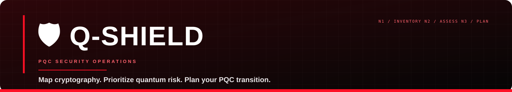
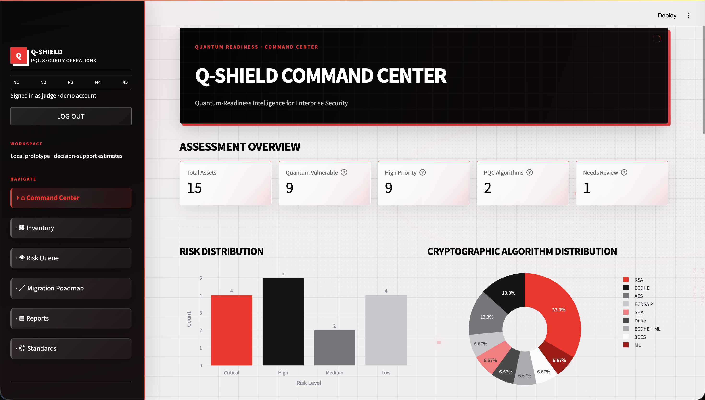

# 

Q-Shield turns a declared cryptographic inventory into a clear, evidence-led view of quantum exposure and migration priorities. It brings asset inventory, transparent detection and risk analysis, PQC migration planning, standards references, and shareable reports into one local-first workspace.

## 🚀 Live Demo

🔗 **Live Application:** https://q-shield-abcde.streamlit.app/

Explore Q-Shield, an AI-assisted cybersecurity platform designed to help organizations assess cryptographic risks and plan their transition to Post-Quantum Cryptography (PQC).

> **Prototype notice:** Q-Shield analyzes information people declare or upload; it does not discover cryptography in live systems, certify compliance, or perform migrations. Treat findings as planning estimates, review them with qualified owners, and use synthetic or sanitized data in demos.

## 🌟 At a glance

- **Inventory:** Upload CSV or JSON, review and filter assets, add or edit records, capture structured cryptographic usages and evidence, and export inventory data.
- **Detection and risk:** Run deterministic algorithm classification and explainable 0–100 migration-priority scoring; inspect findings, score factors, and review flags.
- **Migration planning:** Browse risk-ranked recommendations, record migration status, view evidence-based progress, and optionally request an AI-assisted plan.
- **Reports:** Generate a paginated PDF and download inventory or assessment CSV files from current data.
- **Standards and method:** Review the project’s standards reference, detection rules, scoring approach, and known limitations.
- **Command Center:** See assessment summaries, distributions, priority assets, and recent workspace activity.

## 🖥️ Interface preview

The screenshot below shows the Command Center with the synthetic demo workspace loaded (15 assets).



## 🔄 How the workflow fits together

```text
CSV / JSON / demo data
        ↓
Inventory + evidence → Algorithm detection → Explainable risk scores
                                                   ↓
                              Migration recommendations and progress
                                                   ↓
                                   PDF / CSV reports and references
```

The same local database backs the dashboard, inventory, risk queue, migration planner, and reports, so their views use the shared assessment records. AI advice is an optional layer: it does not replace deterministic findings or change risk scores.

## 🚀 Run locally

### 🧰 Requirements

- Python **3.12** (the pinned Streamlit deployment runtime is recorded in [`runtime.txt`](runtime.txt))
- `pip`

### ▶️ Install and start

```bash
git clone https://github.com/zainabanargizshah-mist/QAudit.git
cd QAudit

python3.12 -m venv .venv
source .venv/bin/activate        # macOS / Linux
# .venv\Scripts\activate         # Windows PowerShell

python -m pip install --upgrade pip
python -m pip install -r requirements.txt
streamlit run app.py
```

Open the local URL printed by Streamlit, usually <http://localhost:8501>.

### 🔐 Demo sign-in and sample data

The local presentation login defaults to:

```text
Username: judge
Password: qshield-demo
```

After sign-in, choose **Load Demo Data** in the sidebar or Inventory module to populate the workspace with synthetic records. You can also start with the project’s sample inventories:

- [Synthetic sample inventory (15 rows)](data/qshield_synthetic_inventory.csv)
- [Synthetic sample inventory (25 rows)](data/qshield_synthetic_inventory_25.csv)

The login is a demo session gate, not production authentication: it does not provide user accounts, roles, tenant isolation, password recovery, or enterprise identity integration. The default credentials are public. Override them for a local presentation with `QSHIELD_DEMO_USERNAME` and `QSHIELD_DEMO_PASSWORD`.

**Workspace reset behavior:** Successful login and logout clear the shared local asset inventory and its derived assessment records. The activity log and original CSV files on disk are retained. Export or copy anything you need before logging out; this behavior is intended for the single-user demo workspace.

## 🤖 Optional AI assistant

The application works without provider credentials. Rule-based analysis and migration recommendations remain available. To enable optional language-model guidance, create a local `.env` file:

```bash
cp .env.example .env
```

Add a valid `GEMINI_API_KEY` (preferred) or `OPENAI_API_KEY`. Optional model settings are `QSHIELD_GEMINI_MODEL` and `QSHIELD_AI_MODEL`. Keep `.env` private and out of version control. The app reads secrets from the process environment or Streamlit secrets as well.

The AI assistant is advisory. The migration planner sends a limited, anonymized assessment summary to the selected provider; it excludes asset names, IDs, owners, notes, and raw uploaded source files. Review provider terms and your organization’s data policy before enabling any external AI service.

## 🗃️ Data and assessment behavior

- **Storage:** SQLite, by default `qshield.db` in the project directory. Set `QSHIELD_DB_PATH` to choose another path.
- **Import:** CSV and JSON uploads are validated before import. CSV headers map to the asset fields; JSON accepts an array of objects or an object containing an `assets` array. The default limits are 10 MB per upload and 5,000 records; set `QSHIELD_MAX_UPLOAD_MB` or `QSHIELD_MAX_RECORDS` to change them.
- **Detection:** Rule-based classification covers common quantum-vulnerable public-key algorithms, recognized PQC algorithms, symmetric and hash algorithms, hybrid labels, and unknown values that need manual review.
- **Risk score:** A versioned 0–100 weighted planning heuristic considers cryptographic exposure, data sensitivity and retention, business criticality, internet exposure, dependencies, and evidence uncertainty. Each result includes a factor breakdown, explanation, priority band, and suggested actions. These are not probabilities, CVSS ratings, or official NIST classifications.
- **Migration progress:** Status and evidence are tracked per asset; completion is not inferred from an algorithm label. Reported status is not independently verified by Q-Shield.
- **Exports:** Inventory CSV, combined assessment CSV, and a generated PDF report are produced from the current local workspace.

## 🧩 Project map

```text
QAudit/
├── app.py                         # Command Center and Streamlit entry point
├── pages/
│   ├── 1_Asset_Inventory.py       # Import, edit, filter, and export inventory
│   ├── 2_Risk_Assessment.py       # Detection findings and risk analysis
│   ├── 3_Migration_Planner.py     # Recommendations, progress, optional AI
│   ├── 4_Reports.py               # PDF and CSV reporting
│   └── 5_Methodology.py           # Methodology and standards references
├── qshield/
│   ├── auth.py                    # Local demo login and workspace reset
│   ├── database.py                # SQLite persistence
│   ├── models.py                  # Shared asset and result models
│   ├── validation.py              # Upload and input validation
│   ├── inventory.py               # Demo data and inventory operations
│   ├── detection.py               # Cryptographic classification rules
│   ├── risk_engine.py             # Explainable scoring
│   ├── assessment.py              # Shared assessment pipeline
│   ├── recommendations.py         # Migration recommendations
│   ├── migration_plan.py          # Progress and migration-plan data
│   ├── ai_assistant.py            # Optional provider integrations
│   ├── reporting.py               # PDF and CSV generation
│   ├── standards.py               # Canonical standards-reference loader
│   └── ui.py                      # Shared navigation, styles, and components
├── data/
│   ├── standards_reference.json   # Standards metadata
│   ├── qshield_synthetic_inventory.csv
│   └── qshield_synthetic_inventory_25.csv
├── docs/                          # Project notes and interface preview
├── tests/                         # pytest coverage for core modules and UI
├── requirements.txt               # Runtime dependencies
└── requirements-dev.txt            # Runtime dependencies plus pytest
```

## 🧪 Run tests

```bash
python -m pip install -r requirements-dev.txt
python -m pytest tests/ -v
```

The suite covers authentication, AI behavior, validation, inventory, detection, scoring, migration planning, reporting, remediation, and selected UI regressions.

## ⚙️ Configuration reference

| Variable | Purpose | Default |
|---|---|---|
| `QSHIELD_DB_PATH` | SQLite database location | `qshield.db` |
| `QSHIELD_MAX_UPLOAD_MB` | Maximum upload size | `10` |
| `QSHIELD_MAX_RECORDS` | Maximum imported records | `5000` |
| `QSHIELD_DEMO_USERNAME` | Local demo username | `judge` |
| `QSHIELD_DEMO_PASSWORD` | Local demo password | `qshield-demo` |
| `GEMINI_API_KEY` | Optional preferred AI provider | unset |
| `OPENAI_API_KEY` | Optional fallback AI provider | unset |
| `QSHIELD_GEMINI_MODEL` | Gemini model override | `gemini-3.8-flash` |
| `QSHIELD_AI_MODEL` | OpenAI model override | `gpt-4o-mini` |

See [`.env.example`](.env.example) for the complete template and deployment notes.

## 🧭 Scope and limitations

- Inventory is declared or uploaded; the app does not scan source code, hosts, networks, certificates, or live traffic.
- Detection depends on the labels and evidence provided and may require manual review for aliases or unknown values.
- Risk scores and migration recommendations are estimates for prioritization, not security guarantees or compliance determinations.
- The demo authentication and local SQLite workspace are designed for local demonstration, not shared or production operation.
- AI responses can be incomplete or incorrect and must be reviewed by a person.
- PQC standards and transition guidance evolve; use the linked official references and your organization’s current policy.

## 📚 Standards references

Q-Shield’s reference module includes entries for NIST PQC standards and related guidance. Consult the official sources for authoritative and current requirements:

- [NIST FIPS 203 — Module-Lattice-Based Key-Encapsulation Mechanism](https://csrc.nist.gov/pubs/fips/203/final)
- [NIST FIPS 204 — Module-Lattice-Based Digital Signature Standard](https://csrc.nist.gov/pubs/fips/204/final)
- [NIST FIPS 205 — Stateless Hash-Based Digital Signature Standard](https://csrc.nist.gov/pubs/fips/205/final)
- [NIST IR 8547 — Transition to Post-Quantum Cryptography Standards](https://csrc.nist.gov/pubs/ir/8547/final)
- [OWASP Top 10:2021 — A02 Cryptographic Failures](https://owasp.org/Top10/A02_2021-Cryptographic_Failures/)

## 🎓 License and use

This repository is provided for educational, demonstration, and assessment-planning use. No production security or compliance guarantee is provided.

---

**Q-Shield · PQC Security Operations**
